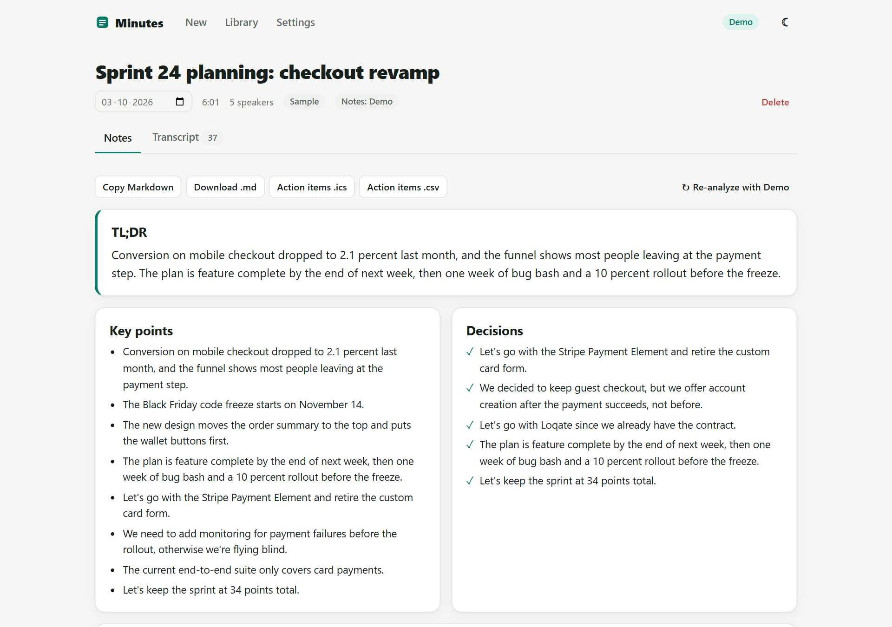
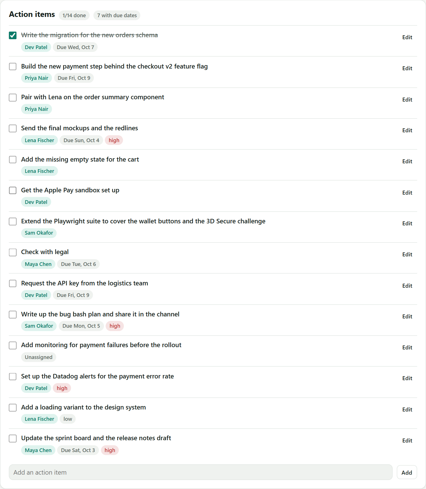
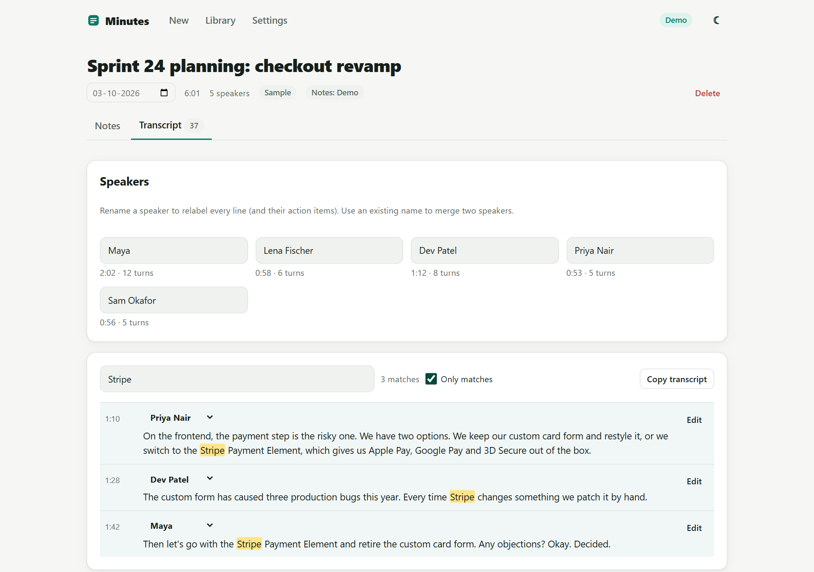
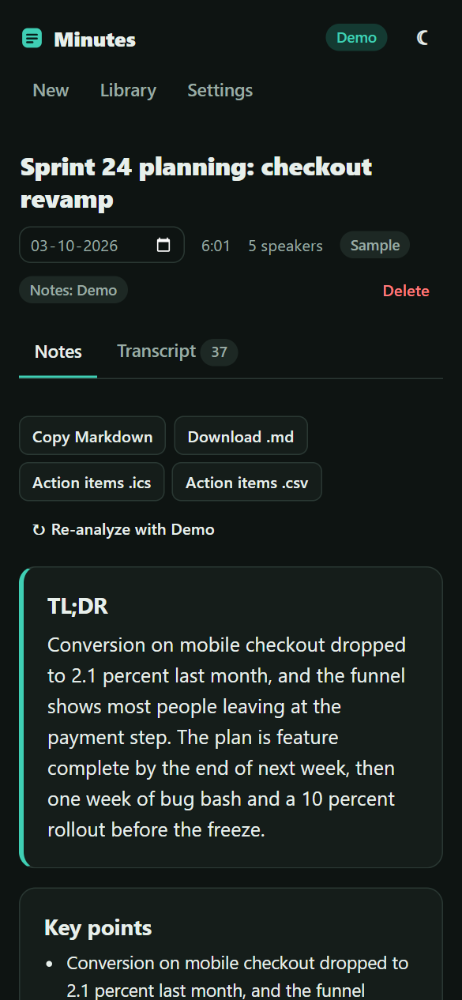
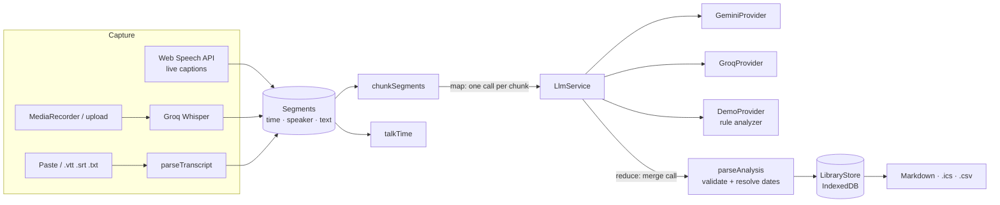

# Minutes: AI meeting notes


Turn meetings into notes people act on. Capture a meeting with live captions, record or upload audio for Whisper transcription, or paste a transcript from Zoom, Teams or Meet. Minutes writes a TL;DR, key points, decisions, open questions and action items with owners, priorities and real due dates ("by Friday" becomes a date). Tick items off, then export them to your calendar (.ics), a spreadsheet (.csv) or Markdown.

**[▶ Live demo](https://konicamaheshwarii.github.io/meeting-notes-ai/)**: opens in Demo mode with three sample meetings, no key or sign-up needed.



## Features

- **Four ways to capture.** Live captions with the Web Speech API (interim and final text, a timestamp per line, pause/resume, tap who is speaking). Audio recorded with `MediaRecorder` or uploaded from disk is transcribed by Groq Whisper (`whisper-large-v3-turbo`, with segment timestamps). Transcript files (.txt, .vtt, .srt) and pasted text are parsed locally.
- **Transcript parser.** Understands `Name: text` lines, `[00:12]` / `00:01:23` timestamps, `Name (0:12): text`, Zoom/Teams `Name  0:12` headers and WebVTT/SRT cues with `<v Name>` voice tags. Without timestamps, times are estimated from word count.
- **Transcript editor.** Search with highlighted matches, rename or merge speakers (their action items follow), reassign or edit lines.
- **Structured AI notes.** Title, TL;DR, key points, decisions, action items `{task, owner, due, priority}`, open questions and tone, returned as JSON and validated before use.
- **Long meetings.** Transcripts are split into chunks at segment boundaries and summarised part by part, then merged (map-reduce), with step-by-step progress. If the merge reply is unusable, the partial notes are merged locally instead of failing.
- **Talk time per speaker,** computed in the browser from timestamps, not guessed by the AI.
- **Action items that leave the app.** A persisted checklist with inline editing, export to `.ics` (all-day events on each due date) and `.csv`, plus copy or download the notes as Markdown.
- **Library.** Every meeting is saved in IndexedDB (localStorage fallback) with search over titles, notes, people and transcripts.
- **Offline Demo mode (default).** A rule-based analyzer finds action items from phrases like "I'll…", "can you…", "we need to…" and "can someone…" / "I can take that", decisions from "we decided" / "let's go with", owners from speaker names, open questions, tone, and an extractive TL;DR from the highest-scoring sentences. Relative due dates ("by Friday", "next week", "end of month", "Oct 12th") are resolved against the meeting date.
- **Bring your own key.** Google Gemini or Groq for notes; a Groq key also unlocks Whisper. Keys stay in your browser and go straight to the provider; there is no backend.
- **Light/dark themes, keyboard-friendly tabs and a layout that works down to 390px.**

| Action items | Transcript search | Mobile, dark |
|---|---|---|
|  |  |  |

## Architecture



Key design decisions:

- **One pipeline for every provider.** The Demo provider answers the same `analyze-chunk` and `merge` requests a real model gets, so Demo mode exercises the real map-reduce path, streaming and progress UI.
- **Defensive AI output handling.** Replies are stripped of code fences, prose and `<think>` blocks, then validated: camelCase or snake_case keys, owners matched to real speaker names, priorities normalised, and due dates checked as ISO or resolved from phrases like "Friday" relative to the meeting date.
- **Prompt-injection hygiene.** Transcripts and partial notes are fenced in `<transcript>` / `<partial_notes>` tags and the system prompt treats them as data.
- **Deterministic numbers stay local.** Talk time, durations and date arithmetic are computed in code; the model only writes language.
- **Signals and zoneless change detection** with `OnPush` standalone components, `@if`/`@for` control flow and lazy-loaded routes (about 67 kB initial transfer).
- **Persistence that degrades gracefully.** IndexedDB first, then localStorage if IndexedDB is blocked.
- **Standards-compliant exports.** RFC 5545 iCalendar (CRLF, escaping, 75-octet line folding) and RFC 4180 CSV with spreadsheet formula injection defused.

```
src/app
├── core
│   ├── analysis/      rule analyzer, due-date resolver, prompts, validation, map-reduce pipeline
│   ├── export/        Markdown, iCalendar and CSV exporters
│   ├── library/       IndexedDB / localStorage backends, LibraryStore, search
│   ├── llm/           provider interface, Gemini, Groq, Demo, SSE reader
│   ├── transcript/    transcript parser, talk time, chunker, Whisper client
│   ├── samples.ts     bundled demo meetings
│   └── settings.store.ts
├── features/          capture · meeting (notes + transcript) · library · settings
└── shared/            live captions, audio recorder, download/clipboard helpers
```

## Getting started

```bash
npm install
npm start          # http://localhost:4200
npm run test:ci    # unit tests in headless Chrome
npm run build
```

Open **Settings** to switch from Demo to Gemini or Groq and paste a free key:
[Gemini](https://aistudio.google.com/apikey) · [Groq](https://console.groq.com/keys). A Groq key also enables transcription of recordings and audio uploads (up to 25 MB per file).

Live captions need a browser with the Web Speech API (Chrome, Edge or Safari).

## Testing

42 unit tests cover the logic most likely to break: the transcript parser (speaker lines, timestamps, WebVTT/SRT, Zoom headers, estimated times), talk-time calculation, chunking and map-reduce merging (including the fallback when the merge reply is junk), the rule analyzer's action-item, decision and open-question patterns, due-date resolution ("by Friday" vs "next Friday", business days, year rollover), AI JSON validation, Markdown/iCalendar/CSV export, library search and persistence, and SSE parsing.

CI (GitHub Actions) runs the tests and the production build on every push, then deploys `main` to GitHub Pages.

## License

[MIT](LICENSE)
